# KalaOS

**KalaOS is my authored portfolio operating system:** a visual profile experience that introduces who I am, what I build, and the work I care about.

I’m Kalaab Alebachew, a software engineering student and full-stack developer in Addis Ababa. I build mobile and web products, with a focus on practical tools, clear interfaces, and maintainable systems.

## What I build

- Cross-platform apps with **Flutter and Dart**
- Web interfaces with **React**
- APIs and backend services with **Node.js** and **Python/FastAPI**
- Data-backed products using **MongoDB**

## Selected projects

- [GitHub Repository Inspector](https://github.com/kalaabalb/github-repo-inspector) — turns public repositories into bounded, evidence-backed technical reports.
- [Family Academy Client](https://github.com/kalaabalb/family-academy-client) — Flutter learning app for courses, study materials, exams, and student progress.
- [Family Academy Admin](https://github.com/kalaabalb/family-academy-admin) — React dashboard for managing educational content and platform operations.
- [Family Academy Landing Page](https://github.com/kalaabalb/familyacademy.et) — public landing page and download hub.
- [KalaOS Portfolio](https://kalaabalb.github.io) — the live portfolio experience.

## Contact

- Email: [kalaab.alb@gmail.com](mailto:kalaab.alb@gmail.com)
- GitHub: [@kalaabalb](https://github.com/kalaabalb)
- Portfolio: [kalaabalb.github.io](https://kalaabalb.github.io)

## KalaOS experience

The sections below are visual chapters in the KalaOS experience. Each chapter
also has a plain-text description, so the profile remains understandable if an
image cannot load.

### ORIGIN

The starting point: the principles and visual language behind KalaOS.

<picture>
  <source media="(prefers-color-scheme: dark)" srcset="./assets/generated/origin-dark.svg">
  <source media="(prefers-color-scheme: light)" srcset="./assets/generated/origin-light.svg">
  
</picture>

### BOOT

The boot sequence introduces the profile and brings the experience to life.

<picture>
  <source media="(prefers-color-scheme: dark)" srcset="./assets/generated/boot-dark.svg">
  <source media="(prefers-color-scheme: light)" srcset="./assets/generated/boot-light.svg">
  
</picture>

### IDENTITY

An overview of the person and work behind the portfolio.

<picture>
  <source media="(prefers-color-scheme: dark)" srcset="./assets/generated/identity-dark.svg">
  <source media="(prefers-color-scheme: light)" srcset="./assets/generated/identity-light.svg">
  
</picture>

### SYSTEMS

The tools and technical foundations used to make products.

<picture>
  <source media="(prefers-color-scheme: dark)" srcset="./assets/generated/systems-dark.svg">
  <source media="(prefers-color-scheme: light)" srcset="./assets/generated/systems-light.svg">
  
</picture>

### TELEMETRY

Signals from projects, progress, and ongoing work.

<picture>
  <source media="(prefers-color-scheme: dark)" srcset="./assets/generated/telemetry-dark.svg">
  <source media="(prefers-color-scheme: light)" srcset="./assets/generated/telemetry-light.svg">
  
</picture>

### CHRONOLOGY

A timeline of the path and milestones that shape the work.

<picture>
  <source media="(prefers-color-scheme: dark)" srcset="./assets/generated/chronology-dark.svg">
  <source media="(prefers-color-scheme: light)" srcset="./assets/generated/chronology-light.svg">
  
</picture>

### SIGNALS

Ideas and patterns that guide the products I build.

<picture>
  <source media="(prefers-color-scheme: dark)" srcset="./assets/generated/signals-dark.svg">
  <source media="(prefers-color-scheme: light)" srcset="./assets/generated/signals-light.svg">
  
</picture>

### INTERFACE

The interaction and visual design of the KalaOS portfolio.

<picture>
  <source media="(prefers-color-scheme: dark)" srcset="./assets/generated/interface-dark.svg">
  <source media="(prefers-color-scheme: light)" srcset="./assets/generated/interface-light.svg">
  
</picture>

### HANDOFF

Ways to explore the work and get in touch.

<picture>
  <source media="(prefers-color-scheme: dark)" srcset="./assets/generated/handoff-dark.svg">
  <source media="(prefers-color-scheme: light)" srcset="./assets/generated/handoff-light.svg">
  
</picture>
